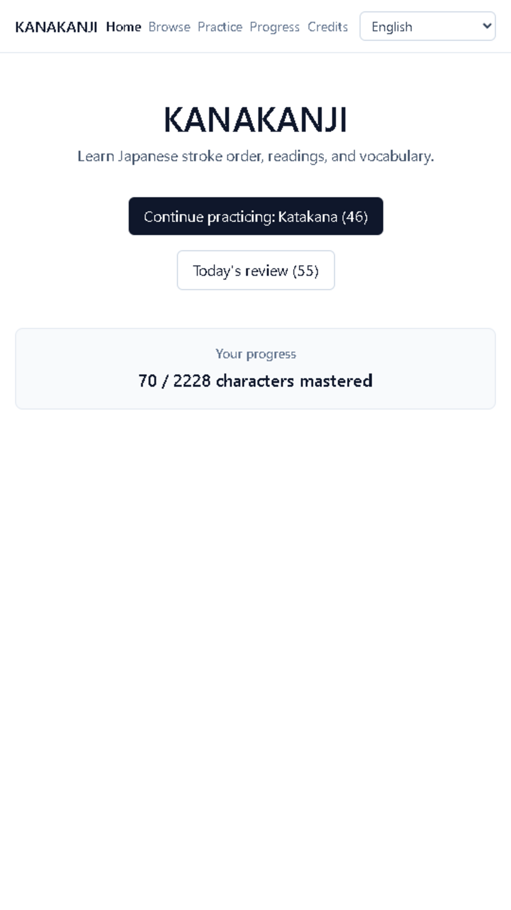
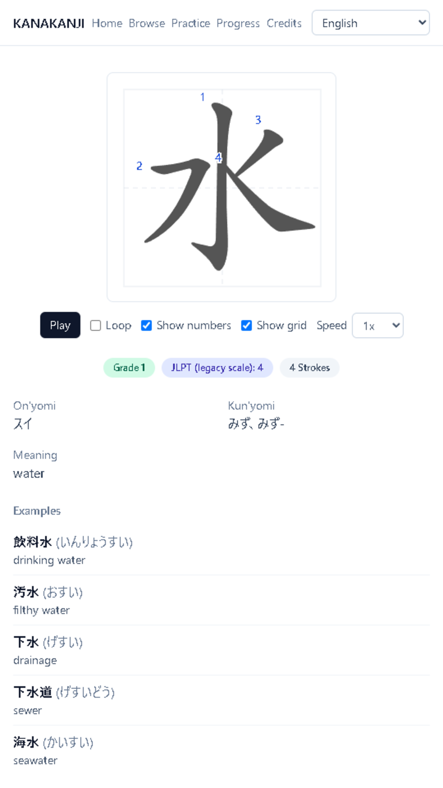
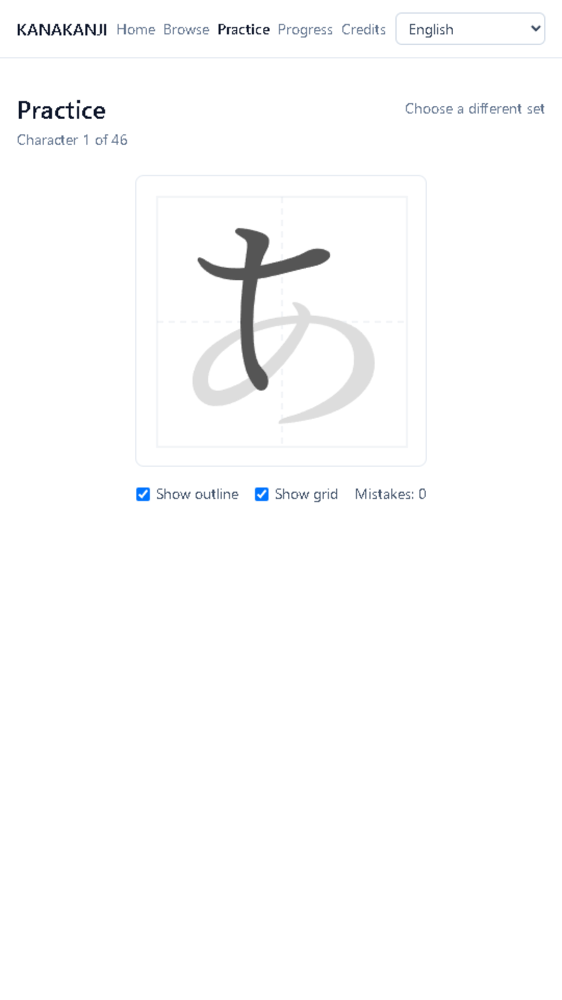

# KANAKANJI

Practice Japanese hiragana, katakana, and all 2,136 jōyō kanji — stroke order,
readings, and vocabulary — free, ad-free, and fully offline.

[**Live demo → kanakanji.pages.dev**](https://kanakanji.pages.dev) &nbsp;|&nbsp;
[**Download Android APK**](https://kanakanji.pages.dev/download/kanakanji.apk) &nbsp;|&nbsp;
[**APK via GitHub Releases**](https://github.com/SHINZO111/kana-kanji-app/releases/latest/download/kanakanji.apk)

日本語版: [README.ja.md](README.ja.md)

<p align="center">
  
  
  
</p>

## Features

- **Trace-to-learn** — draw each character stroke by stroke with live
  correctness feedback (powered by [Hanzi Writer](https://hanziwriter.org/))
- **Numbered stroke order** — every kana and kanji shows its correct stroke
  sequence, animated or step-by-step
- **Spaced repetition (SRS)** — practice attempts feed a per-character
  mastery schedule so review time goes where it's needed
- **12 UI languages** — the interface is fully localized (English, Spanish,
  French, Indonesian, Japanese, Korean, Portuguese, Vietnamese, Chinese, and
  more — see `src/lib/i18n/`)
- **Full coverage** — 92 kana (hiragana + katakana) and all 2,136 jōyō kanji,
  with readings and example vocabulary
- **Completely offline** — installs as a PWA or Android app; all character
  data is bundled/precached, no network round-trip needed after first load
- **No ads, no trackers, no account** — progress is stored locally on your
  device (IndexedDB) and never leaves it

## Getting started

```bash
git clone https://github.com/SHINZO111/kana-kanji-app.git
cd kana-kanji-app
npm install
npm run build:data   # generates public/data/ (kana, kanji, index, stroke data)
npm run dev           # http://localhost:5174
```

`npm run build:data` downloads KANJIDIC2/JMdict and stroke-order source data
and can take a few minutes on first run — see
[Data pipeline](#data-pipeline) below for what each step does. It only needs
to be re-run when the underlying data changes; day-to-day development just
needs `npm run dev`.

Other useful commands:

```bash
npm run build     # production build -> dist/
npm test          # unit tests (vitest)
npm run test:e2e  # end-to-end tests (playwright)
npm run lint       # oxlint
```

## Data pipeline

The app's character data (`public/data/`) is generated by scripts under
`data-pipeline/`, not hand-authored (except the 92 kana definitions and
their romaji, which are hand-written in `data-pipeline/lib/kana-table.mjs`).

| Script | What it does |
|---|---|
| `npm run data:download` | Downloads + decompresses KANJIDIC2 and JMdict_e from EDRDG into `data-pipeline/raw/` (gitignored) |
| `npm run data:kana` | Writes `public/data/kana.json` from the hand-written kana table |
| `npm run data:kanji` | Parses KANJIDIC2 and writes one JSON file per jōyō kanji under `public/data/kanji/{codepoint}.json` |
| `npm run data:words` | Streams JMdict_e and merges up to 5 example words (priority-tagged) into each kanji's JSON |
| `npm run data:strokes` | Populates `public/data/strokes/{codepoint}.json` (gitignored) for every kana + kanji character |
| `npm run data:index` | Builds `public/data/index.json`, the combined lightweight index used by Browse/search |
| `npm run data:check-strokes` | Verifies no character is missing stroke data |

`npm run build:data` runs all of the above in order.

**Stroke data sourcing, briefly:** kanji stroke data comes from the
[`hanzi-writer-data-jp`](https://github.com/chanind/hanzi-writer-data-jp)
GitHub repo (the published npm package ships no character data, only stub
files — the pipeline downloads the repo directly). That dataset has no
hiragana/katakana, so kana stroke data is instead generated from
[KanjiVG](https://kanjivg.tagaini.net/) SVGs, converted with a ported
version of
[Moritz72/KanjiVGToHanziWriterConverter](https://github.com/Moritz72/KanjiVGToHanziWriterConverter)
(MIT). A handful of 2010-jōyō glyph variants that aren't present in the
dataset under their exact codepoint are substituted with their
visually-identical common-form variant — see `VARIANT_FALLBACK` in
`data-pipeline/build-strokes.mjs`.

`data-pipeline/raw/` and `public/data/strokes/` are gitignored generated
artifacts; `public/data/kana.json`, `public/data/kanji/*.json`, and
`public/data/index.json` are committed (~2.3MB combined).

## Android build

The Android app is a thin native shell around the same web build, via
[Capacitor](https://capacitorjs.com/).

**Prerequisites:** Node.js/npm, JDK 17+, and the Android SDK (Platform 36 +
matching Build-Tools + Platform-Tools — easiest via
[Android Studio](https://developer.android.com/studio)'s SDK Manager). Point
Gradle at the SDK with the `ANDROID_HOME` env var or `android/local.properties`
(`sdk.dir=...`, gitignored).

```bash
npm run android:sync    # npm run build && npx cap sync android
npm run android:build   # android:sync, then gradlew assembleDebug
```

The debug APK lands at `android/app/build/outputs/apk/debug/app-debug.apk`.
Release signing is wired into `android/app/build.gradle` via a gitignored
`android/keystore.properties` — see comments in that Gradle file for the
expected format. Without a keystore present, release builds fall back to
unsigned; debug builds are unaffected.

## Data sources & licenses

KANAKANJI's own source code is MIT-licensed (see [LICENSE](LICENSE)).
Bundled character and dictionary data carry their own licenses and are
**not** covered by the MIT grant:

| Source | Used for | License |
|---|---|---|
| [animCJK](https://github.com/parsimonhi/animCJK) / Make Me a Hanzi (via [`hanzi-writer-data-jp`](https://github.com/chanind/hanzi-writer-data-jp)) | Kanji stroke order data | Arphic Public License / GNU LGPL v3+ |
| [KANJIDIC2](https://www.edrdg.org/wiki/index.php/KANJIDIC_Project) | Kanji readings/meanings | EDRDG, CC BY-SA 4.0 |
| [JMdict](https://www.edrdg.org/jmdict/j_jmdict.html) | Example vocabulary | EDRDG, CC BY-SA 4.0 |
| [Hanzi Writer](https://hanziwriter.org/) | Stroke rendering/animation library | MIT |

This table mirrors `src/lib/i18n/credit-meta.ts`, the source of truth also
shown on the in-app Credits page — check that file if this table and the app
ever disagree.

## Contributing

Bug reports, feature ideas, and pull requests are welcome — see
[CONTRIBUTING.md](CONTRIBUTING.md), which also covers where to send
translation fixes.

## License

Code: [MIT](LICENSE). Bundled data: see [Data sources & licenses](#data-sources--licenses)
above.

---

日本語版 README: [README.ja.md](README.ja.md)
